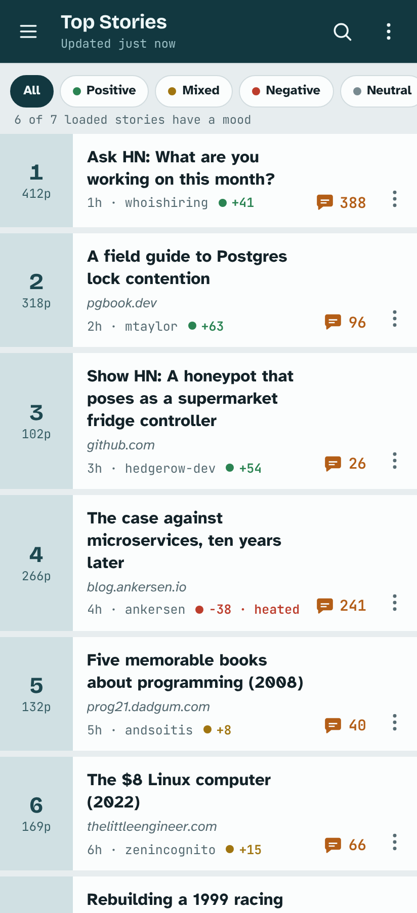
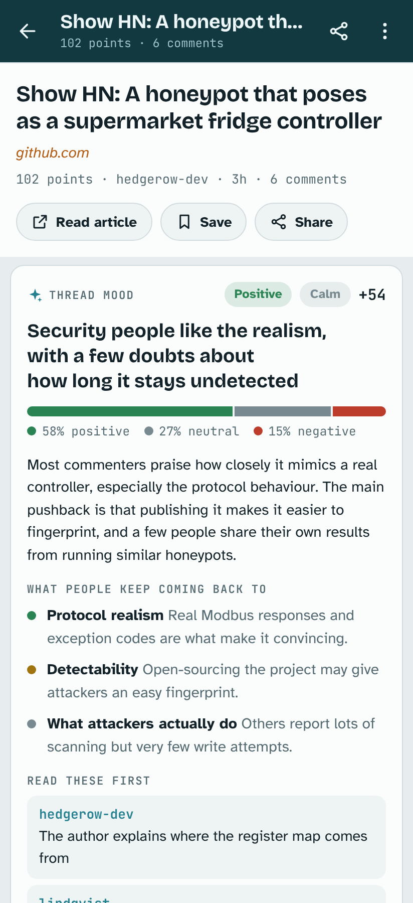
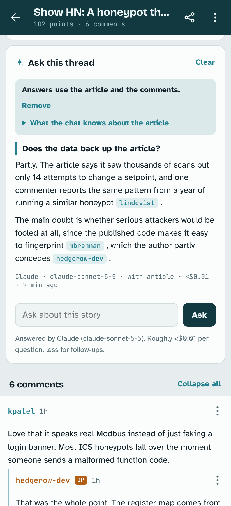

# Undercurrent

A Hacker News reader with 'bring your own AI for thread analysis and chat. It's a single HTML file that runs in your browser, and the AI part works with your own API key from Anthropic, OpenAI or Google.

https://jimliddle.github.io/hacker-news-ai/

<p>
  
  
  
</p>

<sub>Screenshots use sample stories and comments.</sub>

## What it does

When you open a discussion, the first thing you see is a read of the comments as a whole. It tells you whether people are broadly positive, negative or split, gives a score from -100 to +100, says whether the thread is calm or heated, and lists the points people keep coming back to. It also picks out two or three comments worth reading first, and tapping one jumps straight to it.

Under that summary you can ask questions, such as "what are the main objections?" or "does the data back up the article?". Answers draw on the linked article as well as the comments, say when a point comes from the article, and link to the comments they're based on. The first time you ask about a story, the AI provider reads the article and condenses it into notes, which are kept for that story. A strip above the questions always says what the answers can see, and you can open it to read the notes. If the provider can't read the page, because of a paywall or a login for example, you can paste the article's text in instead.

You can share a thread's summary with anyone. They get a readable message with the mood, the main themes and the article and discussion links, plus a link that opens the thread in the app with your summary already showing. They don't need an API key to see it, and you choose whether your questions and answers go with it.

Stories you've already analysed show their mood on the front page, so you can filter the list down to positive threads or hide the heated ones. If you switch on pre-reading, a cheaper model reads the top 5 to 30 stories in the background whenever a feed loads. You can also analyse any single story from its menu without opening it.

The rest is what you'd want from an HN reader. There are Top, New, Best, Ask, Show and Jobs feeds and search. Comment threads collapse, and you can save stories and individual comments. Stories you've read are greyed out, with a count of new comments since your last visit. You can choose between four themes, adjust the text size and install it as an app on your phone or desktop.

## Getting started

1. Put `index.html` on any host that serves over HTTPS. The quickest option is GitHub Pages: in this repo's settings, open Pages and deploy from the `main` branch.
2. Open the page and go to Settings.
3. Paste in an API key for Claude, OpenAI or Gemini. If you add more than one, choose which one to use.

To try it locally, run `python3 -m http.server` in this folder and open `http://localhost:8000`. Opening the file straight from disk is unreliable, because some browsers restrict storage and encryption on local files and none of them will install it as an app.

## Your keys and data

The app has no server and no analytics. The only requests it makes go to Hacker News (the official API plus Algolia's search) and to the AI provider you've chosen.

Your browser never contacts the sites that stories link to. When the app reads an article, it asks your AI provider to fetch the page on its own servers, using Anthropic's web fetch tool or Gemini's URL context tool. The provider already sees each story's link in the prompts, so this tells it nothing new about what you're reading. Article text you paste in goes only to your provider.

API keys are encrypted with AES-GCM using a key the browser generates and can't export, then stored in IndexedDB. Each key has its own Clear button in Settings. There are separate buttons for saved items, reading history and cached analyses, and one that wipes everything.

The page sets a strict Content Security Policy. The only script allowed to run is the one inside the file, pinned by its hash, and the page can only connect to the HN APIs and the three AI providers. Comment HTML goes through an allowlist before it's displayed.

Anyone who can use your browser profile can also run analyses with your saved key. On a shared machine, clear your keys when you've finished, and set a spending limit with your provider in any case.

## What it costs

Each analysis is one API call. Long threads are trimmed to about 90,000 characters of comments, which is roughly 25,000 tokens, so with the default models one analysis usually costs a few US cents. Larger models such as Opus cost more. Results are kept per thread, so opening a thread again costs nothing. Questions are cheaper still, and with Claude, follow-up questions reuse a cached copy of the thread.

Reading an article is one more call, made once per story. With Claude Sonnet it typically adds about four cents, and the notes it produces add a little to each question after that. Pre-reading never fetches articles. There's a setting to read the article before every analysis, so the mood card can say whether commenters agree with it. It's off by default because it roughly doubles the cost of each analysis.

The app adds up what you've spent from the token counts each provider sends back, and shows the cost of every analysis and answer. In Settings you can set a monthly limit. Once you reach it, threads stop analysing automatically and wait for you to tap Analyze. Pre-reading has its own daily budget.

Prices for each model can be edited in Settings. The built-in ones may be out of date by the time you read this, and your provider's billing page will always have the exact figure.

## Models

| Provider | Analysis and questions | Pre-reading |
| --- | --- | --- |
| Claude | `claude-sonnet-5-5` | `claude-haiku-5-5` |
| OpenAI | `gpt-5.6-luna` | `gpt-5.4-nano` |
| Gemini | `gemini-3.6-flash` | `gemini-3.6-flash` |

You can type any other model name into Settings. Claude is called straight from the browser using Anthropic's `anthropic-dangerous-direct-browser-access` header, which is what lets the app work without a server in the middle.

## Sharing links

A thread link looks like `https://your-host/#/item/45123456`. A link to a single comment adds the comment's ID: `#/item/45123456/45123999`. Opening a comment link loads the thread, expands anything collapsed above that comment and highlights it. Links to news.ycombinator.com inside comments also open in the app.

Summary links work differently. Share summary (under the mood card, or in a thread's menu) builds a plain-text message you can paste anywhere, ending with a link like `#/item/45123456/s/1fVTLbt...`. Everything after `/s/` is the summary itself, compressed, and any questions and answers you chose to include. A summary with one question comes to around a thousand characters. Browsers never send the part of a URL after the `#` to the server, so the summary goes from your device to theirs without passing through the host.

When someone opens a summary link, the thread loads from Hacker News as normal and the shared summary sits where their own would go, labelled with the model that made it and when. It isn't saved on their device and doesn't trigger an analysis of their own. If they have a key, they can analyse the thread themselves with one tap. Anyone can edit a link, so the app treats shared summaries as untrusted. It checks they belong to the thread they link to, caps their size and shows them as plain text.

## Working on it

There's no build step and no runtime dependencies. Edit `index.html` and reload the page.

The one thing to remember is that the Content Security Policy only lets the inline script run if its SHA-256 hash matches the one in the `<meta>` tag. If you change the script, update the hash before you test, or the page will load without running anything:

```
npm run pin
```

The tests load the app in jsdom with mocked responses from Hacker News and each AI provider, then click through the main features:

```
npm install
npm test
```

`npm test` also runs the pin step first.

## Limitations

- It needs a connection. Offline reading would need a service worker, which has to be a separate file.
- It's read-only. You can't log in, vote or comment.
- Article reading works with Claude and Gemini. OpenAI's API has no tool for fetching a given page, so with OpenAI you paste the article's text in yourself.
- Paywalled pages, pages behind a login and some sites that block automated requests can't be read. Pasting the text works for those too.

## License

MIT
